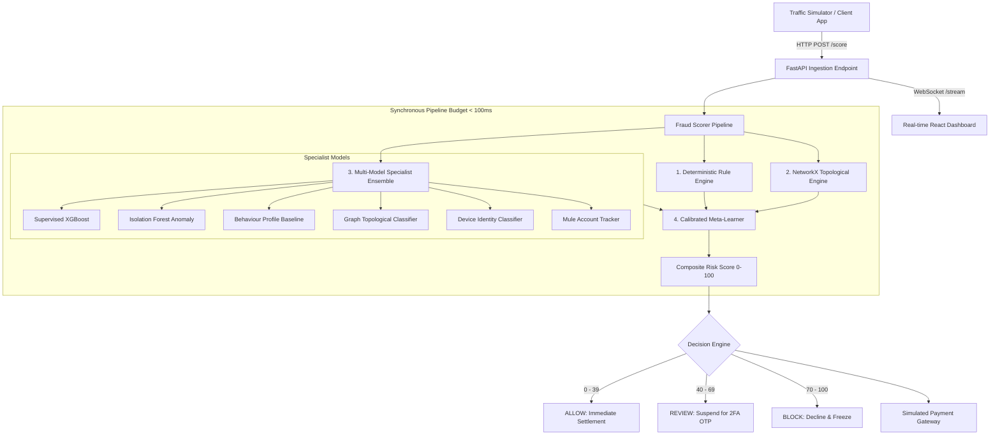

# FraudShield

> Catch the ring, not just the transaction.

[]()
[]()
[]()
[]()
[]()

FraudShield is a real-time instant payment fraud prevention and ring detection engine. Designed to sit inline at payment switches, it evaluates streaming payment transactions against deterministic security rules, topological network analytics, and a multi-model machine learning ensemble to return calibrated risk decisions in milliseconds.

---

## 1. Problem Statement: SW-05 High-Throughput Fraud Detection in Instant Payments

Instant payment systems (e.g. Unified Payments Interface) process billions of transactions monthly with immediate, irreversible bank-to-bank settlement. Fraud patterns have evolved beyond isolated account takeovers into distributed syndicate networks: rapid velocity bursts, mule fan-out aggregation, and circular laundering loops designed to evade per-transaction thresholds.

To protect instant payment switches, the system must enforce deterministic policy rules, extract real-time behavioral features, detect multi-hop cycles, and score payments under strict service-level agreements (< 100 ms).

### Requirements Traceability Matrix

| Requirement | Implementation Detail | Source File |
|---|---|---|
| **Real-time Rule Validator** | Deterministic heuristics (velocity bursts, impossible travel, high-risk merchant categories, round-trip anomalies, structuring). | [`backend/app/rules.py`](backend/app/rules.py) |
| **Topological Ring Detection** | Bounded-length cycle detection ($3 \le k \le 8$) on risk-weighted transaction graph subgraphs. | [`backend/app/graph_engine.py`](backend/app/graph_engine.py) |
| **Sub-100 ms Decision SLA** | Synchronous scoring pipeline averaging $\sim 7.6$ ms execution time. | [`backend/app/scorer.py`](backend/app/scorer.py) |
| **Multi-Model ML Scoring** | 6-model specialist ensemble (XGBoost, Isolation Forest, Profile Baselines, Graph Metrics, Device Clusters, Mule Tracker) fused via a calibrated meta-learner. | [`backend/app/models_ensemble.py`](backend/app/models_ensemble.py) |
| **Traffic Simulation & Attacks** | Stream generator supporting benign transactions, merchant fan-in, velocity attacks, cycle loops, and mule fan-out cashouts. | [`backend/app/simulator.py`](backend/app/simulator.py) |
| **Stateful Payment Gateway** | In-memory simulated payment gateway with 2-factor OTP verification, atomic balance updates, payee resolution, and receipt generation. | [`backend/app/gateway.py`](backend/app/gateway.py) |
| **Operator Dashboard** | Interactive dashboard with real-time WebSocket transaction stream, latency percentiles, and live topology visualization. | [`frontend/src/App.tsx`](frontend/src/App.tsx) |

---

## 2. Architecture



### Risk Decisions & Thresholds
- **`ALLOW` (0–39)**: Transaction cleared for immediate atomic settlement.
- **`REVIEW` (40–69)**: Suspicious activity detected (e.g. velocity burst or unfamiliar payee). Funds are held pending 2-factor OTP authorization.
- **`BLOCK` (70–100)**: High-confidence fraud (e.g. impossible travel or active ring participant). Transaction is rejected; balances remain unchanged.

---

## 3. How Real UPI Works

Unified Payments Interface (UPI) is a **centralized instant payment architecture**, not a blockchain or decentralized ledger:

```
[Payer Mobile App / PSP]
        ↓
[Remitter Bank Core Banking System]
        ↓
[NPCI Central Switch (Clearing & Settlement)]  <--- FraudShield Inline Placement
        ↓
[Beneficiary Bank Core Banking System]
```

1. **Central Clearing**: NPCI (National Payments Corporation of India) operates the central switch routing messages between acquiring PSPs and issuing banks.
2. **Inline Fraud Prevention**: FraudShield sits inline at the switch layer to inspect transaction metadata during routing before clearing confirmation.
3. **Data Privacy & Tokenization**: FraudShield operates exclusively on **tokenized operational metadata**:
   - Virtual Payment Addresses (VPAs / UPI IDs)
   - Account identifier tokens
   - Hashed device fingerprints
   - IP addresses and geographic locations
   - Transaction amounts and timestamps
   - Merchant Category Codes (MCC)
4. **Credential Isolation**: The engine **never** receives, inspects, or logs UPI PINs, bank passwords, debit card numbers, or cryptographic auth payloads.

---

## 4. API Specification

| Endpoint | Method | Description |
|---|---|---|
| `/score` | `POST` | Synchronously scores a payment transaction. Returns risk score, decision (`ALLOW`/`REVIEW`/`BLOCK`), fired rules, and model contributions. |
| `/stream` | `WS` | Real-time WebSocket connection streaming scored transactions and system alerts to connected dashboards. |
| `/metrics` | `GET` | Returns rolling operational telemetry: TPS, mean/p95 latency, decision breakdown, and fraud counts. |
| `/graph` | `GET` | Returns active network nodes, edges, and detected ring clusters for topology visualization. |
| `/simulate/{scenario}` | `POST` | Triggers a simulated transaction stream (`normal`, `velocity_attack`, `ring_attack`, `fanout_cashout`). |
| `/transactions/recent` | `GET` | Returns the rolling buffer of recent scored transactions. |
| `/health` | `GET` | Health check verifying model status, memory limits, and engine readiness. |
| `/reset` | `POST` | Clears ledger records, resets in-memory graph nodes, and restores baseline metrics. |
| `/gateway/pay` | `POST` | Initiates a simulated gateway payment with inline fraud scoring and atomic balance debit. |
| `/gateway/confirm` | `POST` | Confirms a `REVIEW` payment using a 6-digit demo verification OTP. |
| `/gateway/resolve` | `GET` | Resolves account IDs (`ACC_xxxx`), UPI handles (`user@psp`), or 10-digit mobile numbers against registry. |
| `/gateway/accounts` | `GET` | Lists simulated demo bank accounts with current balances. |
| `/gateway/payments` | `GET` | Retrieves chronological history of completed gateway payments. |
| `/gateway/payments/{ref}/receipt` | `GET` | Returns structured JSON payment receipt. |
| `/razorpay/config` | `GET` | Returns public Razorpay test key and mode status. |
| `/razorpay/create-order` | `POST` | Evaluates fraud risk and creates a Razorpay test-mode order if cleared. |
| `/razorpay/verify` | `POST` | Verifies cryptographic signature for a test checkout payment. |

---

## 5. Running the Application

### Prerequisites
- Python 3.11 or higher
- Node.js 18 or higher with npm
- PowerShell (on Windows) or Bash (on Linux/macOS)

### 1. Backend Setup (PowerShell)
```powershell
# Navigate to backend and create virtual environment
cd backend
python -m venv venv
.\venv\Scripts\Activate.ps1

# Install dependencies
pip install -r requirements.txt

# Run FastAPI server
uvicorn app.main:app --host 127.0.0.1 --port 8000 --reload
```

### 2. Frontend Setup (PowerShell)
```powershell
# Navigate to frontend in a new terminal
cd frontend
npm install

# Start Vite dev server
npm run dev
```
Open [http://localhost:5173](http://localhost:5173) in your browser.

### 3. Environment Variables
Frontend configuration requires only one setting:
```env
# frontend/.env
VITE_API_BASE=http://127.0.0.1:8000
```
*(When deployed to production, point `VITE_API_BASE` to your live API URL, e.g. `https://fraudshield-api.onrender.com`).*

### 4. Running Tests
```powershell
# Run the complete pytest suite from project root
.\backend\venv\Scripts\pytest backend/tests/ -v
```

### 5. Running the Audit Benchmark
```powershell
# Execute the comprehensive pipeline audit script
.\backend\venv\Scripts\python backend/scripts/audit_benchmark.py
```

---

## 6. Measured Audit Benchmark Results

> **Benchmark Conditions**: Measured strictly from [`docs/audit_benchmark.json`](docs/audit_benchmark.json) using synthetic transaction traffic on a local Windows 11 laptop on 2026-11-28. No results are rounded up or cherry-picked.

### Pipeline Latency Breakdown (2,000 Transactions after 200 Warmup)
- **Mean Pipeline Latency**: `7.658 ms`
- **Median (p50)**: `7.009 ms`
- **95th Percentile (p95)**: `11.231 ms`
- **99th Percentile (p99)**: `12.852 ms`
- **Maximum Observed**: `74.327 ms`

| Stage | Mean (ms) | p50 (ms) | p95 (ms) | p99 (ms) | Max (ms) |
|---|---|---|---|---|---|
| Rule Engine | 0.122 | 0.093 | 0.314 | 0.436 | 0.691 |
| Feature Extraction (19 features) | 0.068 | 0.048 | 0.178 | 0.265 | 2.069 |
| Supervised Model (XGBoost) | 0.546 | 0.486 | 0.874 | 1.218 | 7.801 |
| Anomaly Detector (Isolation Forest) | 3.745 | 3.409 | 5.564 | 6.158 | 17.614 |
| Behaviour Profile Baseline | 0.011 | 0.012 | 0.024 | 0.027 | 0.055 |
| Graph Topological Model | 0.578 | 0.540 | 0.861 | 1.285 | 3.371 |
| Device Identity Model | 0.457 | 0.371 | 0.705 | 1.102 | 67.358 |
| Mule Tracker | 0.002 | 0.002 | 0.003 | 0.004 | 0.015 |
| Meta-Learner (Fusion) | 2.090 | 1.885 | 3.083 | 3.470 | 16.090 |

### Latency at Graph Scale (Full Pipeline under Network Graph Density)
- **1,000 Accounts** (2,033 edges): Mean `10.188 ms` | p50 `9.504 ms` | p95 `13.555 ms` | p99 `14.444 ms` | Max `14.630 ms`
- **2,500 Accounts** (5,124 edges): Mean `11.075 ms` | p50 `11.923 ms` | p95 `13.736 ms` | p99 `14.006 ms` | Max `14.141 ms`
- **5,000 Accounts** (10,158 edges): Mean `8.242 ms` | p50 `8.041 ms` | p95 `9.683 ms` | p99 `11.113 ms` | Max `11.428 ms`

### API Handler Latency (FastAPI In-Process TestClient, 300 Requests)
- **Mean Latency**: `19.533 ms`
- **Median (p50)**: `19.155 ms`
- **95th Percentile (p95)**: `23.924 ms`
- **99th Percentile (p99)**: `31.267 ms`
- **Maximum Observed**: `34.198 ms`
*(Note: Represents in-process application serializer overhead; does not include physical network transmission).*

### Attack Scenario Detection Rates
- **`velocity_attack`**: **15 / 15 flagged (100.0%)** — `13 BLOCK`, `2 REVIEW`, `0 ALLOW` (Mean Score: `77.5`).
- **`ring_attack`**: **11 / 15 flagged (73.3%)** — `6 BLOCK`, `5 REVIEW`, `4 ALLOW` (Mean Score: `53.7`).
- **`fanout_cashout`**: **7 / 16 flagged (43.8%)** — `3 BLOCK`, `4 REVIEW`, `9 ALLOW` (Mean Score: `47.8`).

### False Positive Rates on Benign Traffic (200 Normal Transactions)
- **Cold Start (Immediately after reset)**: **0.50%** false positive rate (`1 REVIEW`, `0 BLOCK`, Mean Score: `1.55`).
- **Warmed Baseline (After 500-transaction warm-up)**: **3.00%** false positive rate (`6 REVIEW`, `0 BLOCK`, Mean Score: `3.64`).

### Ring Detection Precision & Recall (5,000 Accounts, 8-Member Injected Ring)
- **Members Found**: **7 / 8** (**87.50% Recall**; member 07 serves as an external cashout sink).
- **Innocent Accounts Included**: **0 / 7** (**0.00% Contamination Rate**).
- **Detection Precision**: **100.00%** (**7 true members** / 7 reported ring members).

---

## 7. Limitations

1. **Synthetic Data Only**: All benchmarks, accounts, and training datasets are generated via statistical distributions. The system has not been trained or calibrated on proprietary banking or NPCI production data.
2. **Graph Methods**: "Graph-based" denotes topological algorithms (NetworkX PageRank, degree centrality, clustering coefficients, and bounded-length cycle detection). **No Graph Neural Network (GNN) is trained or deployed**.
3. **Legacy SCC Vulnerability**: Global Strongly Connected Component (SCC) algorithms without bounded-cycle and risk filtering report 261 accounts for an 8-member ring (**254 innocent accounts, 2.7% precision**). Precision depends on the bounded-length cycle filter.
4. **Mule Fan-Out Blindspot**: In `fanout_cashout` scenarios, initial victim payments are indistinguishable from normal retail transfers and pass through (`43.8%` overall scenario detection). Only the downstream aggregation hops get flagged.
5. **False Positive Rates**: While baseline false positives (`3.0%`) fall within standard target bands, cold starts can flag unfamiliar high-amount transfers before baseline establishment.
6. **Local In-Process Benchmark**: Latency metrics reflect single-process execution on a laptop, not high-volume concurrent network load testing across distributed hosts.
7. **In-Memory Volatility**: Graph nodes, account balances, and velocity sliding windows reside in Python process memory. Server restarts wipe transient state.
8. **No API Authentication**: Local development endpoints lack mTLS, API keys, or OAuth2 authorization headers.
9. **Render Deployment Sleeping**: Free-tier cloud instances sleep after 15 minutes of inactivity, dropping in-memory state upon cold spin-up.
10. **Test Mode Razorpay**: Test-mode integration; code and mocked tests only; no real test payment verified yet. No real money moves.

---

## 8. Future Work

*The following components represent designed production paths, not currently deployed implementations:*

1. **Streaming Ingestion**: Production migration to **Amazon Kinesis Data Streams** or Apache Kafka for distributed multi-partition transaction buffering.
2. **Persistent Graph Database**: Transitioning from in-memory NetworkX to **Amazon Neptune** or Neo4j for persistent multi-hop graph storage and temporal traversals across hundreds of millions of nodes.
3. **Analyst Case Management**: Integration with **Amazon OpenSearch** for structured log indexing, full-text search, and historical case investigation.
4. **Graph Neural Networks (GNN)**: Training an inductive Graph Convolutional Network (GCN) or Relational Graph Attention Network (RGAT) via PyTorch Geometric to learn structural embeddings directly from payment subgraphs.
5. **Switch-Level Hardening**: Inline deployment at payment gateways with distributed Redis clusters for stateful sliding windows, mutual TLS (mTLS), and hardware security module (HSM) signature verification.
6. **Cryptographic Audit Ledger**: An append-only, forward hash-chained audit log (SHA-256 blocks linking each scored transaction to previous entries) providing mathematical proof of tamper resistance for compliance audits (tamper-evident, not tamper-proof; not implemented).

---

## License

This project is licensed under the MIT License. See [LICENSE](LICENSE) for details.
