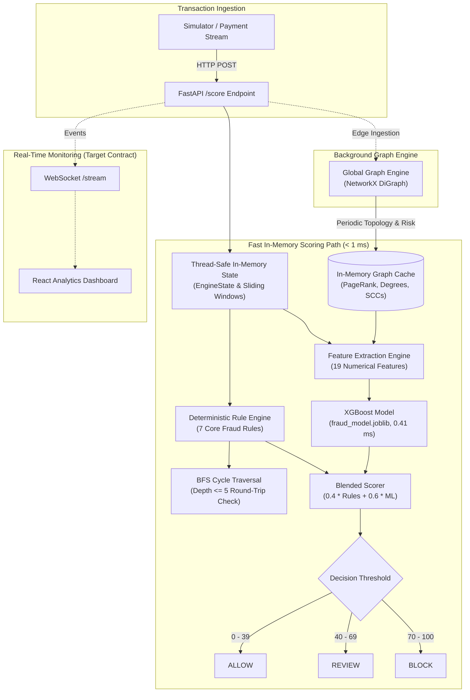
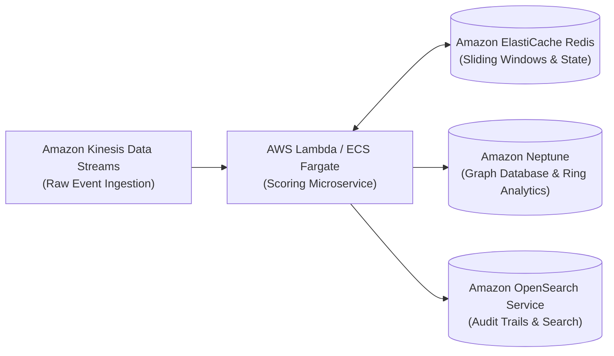

# FraudShield 🛡️

Catch the ring, not just the transaction.

---

## 1. Overview & Problem Statement

**Challenge**: SW-05 High-Throughput Fraud Detection in Instant Payments  
**Track**: Software Track, FinTech / Machine Learning

Instant payment systems (such as UPI) operate under stringent latency requirements: scoring decisions must be delivered in real time without introducing friction into legitimate checkout flows. Traditional fraud systems rely on post-settlement batch analytics or sluggish relational queries that fail to halt coordinated attacks in-flight. Modern financial crime has shifted from isolated rogue transactions to coordinated fraud rings—including high-frequency velocity bursts, circular fund routing (layering), mule networks, and device-sharing syndicates.

### Goals & Status

- **Basic Goal (Completed)**: Real-time, in-memory rule engine evaluating transactional velocity, amount spikes, device sharing, rapid round-tripping, structuring, and receiver fan-in with sub-millisecond execution (well below the 100 ms budget).
- **Advanced Goal (Completed)**: Graph-based fraud ring detection and Machine Learning scoring layer.
  - Multi-hop cycle traversal ($\le 5$ hops) and strongly connected component (SCC) cycle detection.
  - Message-passing graph risk aggregation and centrality metrics (PageRank, clustering, degrees).
  - 19-feature extraction without future leakage replaying chronological payment streams.
  - Pre-trained XGBoost classifier with class-imbalance weighting (`scale_pos_weight=17.62`).
  - Blended scoring ($0.4 \times \text{rules} + 0.6 \times \text{ml}$) with top-feature explainability and 0.41 ms inference latency.

---

## 2. Key Features

- **Sub-Millisecond In-Memory Evaluation**: Evaluates payment streams at over 100,000 transactions per second (TPS) with single-digit microsecond rule evaluation and 0.41 ms ML inference.
- **Hybrid Blended Scoring**: Combines 7 deterministic expert rules (40% weight) with an XGBoost classifier (60% weight) for balanced precision and high recall.
- **19 Real-Time Engineered Features**: Extracts behavioural velocity, account maturity, entity collision ratios, and graph topological signals on-the-fly.
- **Graph Topology & Message Passing**: Computes directed in/out degrees, PageRank centrality, clustering coefficients, strongly connected components, and neighbor average risk scores.
- **Explainable Decision Attribution**: Automatically identifies the top driver behind the ML probability and exposes it within human-readable reason payloads.
- **Stateful Sliding-Window Analytics**: Tracks sender and receiver sliding windows (60s, 300s, 600s) with amortized $\mathcal{O}(1)$ deque updates and pruning.
- **Multi-Hop Cycle Traversal**: In-memory BFS graph inspection (depth $\le 5$) detecting circular money laundering loops between colluding accounts.
- **Fault-Tolerant Fallback**: Gracefully degrades to rule-based scoring if the model artifact is unavailable, ensuring zero downtime or request failure.
- **Built-in Attack Scenario Simulator**: Synthetic generator producing realistic UPI transactions across 500 accounts (400 honest, 100 fraud pool), modeling velocity bursts, cyclic layering, and mule fan-out cashouts.

---

## 3. How It Works

FraudShield unifies high-speed deterministic checks with probabilistic machine learning via a coordinated architecture:

```
                  ┌─────────────────────────┐
                  │  Incoming Transaction   │
                  └────────────┬────────────┘
                               │
               ┌───────────────┴───────────────┐
               ▼                               ▼
     ┌───────────────────┐           ┌───────────────────┐
     │   EngineState     │           │    Graph Cache    │
     │ (Sliding Windows) │           │ (Periodic Update) │
     └─────────┬─────────┘           └─────────┬─────────┘
               │                               │
               └───────────────┬───────────────┘
                               ▼
                   extract_features(txn, ...)
                               │ (19 numeric features)
               ┌───────────────┴───────────────┐
               ▼                               ▼
     ┌───────────────────┐           ┌───────────────────┐
     │    Rule Engine    │           │   XGBoost Model   │
     │    (7 Rules)      │           │ predict_proba()   │
     └─────────┬─────────┘           └─────────┬─────────┘
               │ (rule_score: 0-100)           │ (ml_score: 0-100)
               └───────────────┬───────────────┘
                               ▼
                      scorer.py (Blended)
           final_score = round(0.4*rules + 0.6*ml)
           Reason("ML_MODEL", top_feature, weight)
```

1. **Fast Synchronous Scoring Path ($<1\text{ ms}$ total, budget $<100\text{ ms}$)**:
   - When a transaction arrives at `POST /score`, the engine checks in-memory `EngineState` and `GraphEngine` cache.
   - Evaluates the 7 deterministic rules and calculates `rule_score` (0–100).
   - Extracts 19 numerical features without future leakage and queries the loaded XGBoost model (`predict_proba`).
   - Blends scores: $\text{final\_score} = \operatorname{round}(0.4 \times \text{rule\_score} + 0.6 \times \text{ml\_score})$.
   - Appends an explainable reason (`Reason("ML_MODEL", detail="...", weight=...)`) identifying the top contributing feature.
   - Ingests the edge into the in-memory graph and returns the decision (`ALLOW`, `REVIEW`, or `BLOCK`).

2. **Asynchronous / Periodic Graph Path**:
   - Ingests directed transactions into `NetworkX DiGraph`.
   - Computes PageRank, clustering coefficients, strongly connected components (SCCs), and message-passing neighbor average risk.
   - Refreshes the shared risk cache used by the synchronous feature extraction path.

---

## 4. Architecture



---

## 5. Detection Logic

### 5.1 Deterministic Rule Engine

Every incoming transaction is evaluated against 7 deterministic rules in `backend/app/rules.py`:

| Rule Name | Trigger Condition | Weight | Implementation Details |
|---|---|:---:|---|
| `VELOCITY_BURST` | $>8$ txns by sender in 60 seconds | 30 | Evaluated on `sender_acc.sent_window` (deque of timestamp/amount). |
| `AMOUNT_SPIKE` | Amount $>5\times$ sender's running average | 20 | Requires at least 5 prior sent transactions (`total_sent_count >= 5`). |
| `NEW_ACCOUNT_RISK` | Sender age $<10$ minutes and amount $>3,000$ INR | 15 | Compares `current_time - sender_acc.first_seen < 600s` and `txn.amount > 3000.0`. |
| `SHARED_DEVICE` | Device ID used by $\ge 3$ distinct accounts | 25 | Evaluates unique account set size in `state.device_accounts[txn.device_id]`. |
| `FAN_IN` | Receiver received from $\ge 6$ distinct senders in 5 minutes | 25 | Scans `receiver_acc.received_window` over a 300-second lookback window. |
| `ROUND_TRIP` | Funds returned to sender directly or via chain within 5 minutes | 20 | Direct pair lookup in `pair_times` plus BFS path search up to depth 5 in `pair_graph`. |
| `STRUCTURING` | $\ge 3$ txns by sender in 10 minutes, each between 4,500 and 5,000 INR | 25 | Flags smurfing attempts between 90% and 100% of the 5,000 INR threshold. |

### 5.2 Machine Learning Feature Store (19 Features)

Extracted dynamically by `extract_features(txn, state, graph_cache)` in `backend/app/ml.py`:

| # | Feature Name | Type | Description |
|---|---|:---:|---|
| 1 | `amount` | Float | Transaction monetary value in INR. |
| 2 | `amount_ratio_to_sender_avg` | Float | Current amount divided by sender's historical running average. |
| 3 | `sender_txn_count_1m` | Float | Number of transactions sent by sender in the last 60 seconds. |
| 4 | `sender_txn_count_5m` | Float | Number of transactions sent by sender in the last 300 seconds. |
| 5 | `sender_account_age_seconds` | Float | Elapsed seconds since the sender account was first observed. |
| 6 | `sender_distinct_receivers_5m`| Float | Unique receivers to whom the sender transferred funds in 5 minutes. |
| 7 | `receiver_distinct_senders_5m`| Float | Unique senders from whom the receiver accepted funds in 5 minutes. |
| 8 | `device_shared_accounts` | Float | Number of distinct account IDs linked to the transaction's device ID. |
| 9 | `is_round_trip` | Binary | 1.0 if receiver sent funds back to sender directly or via chain (depth $\le 5$). |
| 10 | `sender_in_degree` | Float | Number of incoming directed payment edges into the sender node. |
| 11 | `sender_out_degree` | Float | Number of outgoing directed payment edges from the sender node. |
| 12 | `receiver_in_degree` | Float | Number of incoming directed payment edges into the receiver node. |
| 13 | `receiver_out_degree` | Float | Number of outgoing directed payment edges from the receiver node. |
| 14 | `sender_pagerank` | Float | PageRank centrality score of the sender in the global payment graph. |
| 15 | `receiver_pagerank` | Float | PageRank centrality score of the receiver in the global payment graph. |
| 16 | `sender_clustering` | Float | Local clustering coefficient of the sender in the payment network. |
| 17 | `in_cycle` | Binary | 1.0 if sender or receiver belongs to a strongly connected component cycle. |
| 18 | `component_size` | Float | Total node count of the weakly connected component containing sender. |
| 19 | `neighbor_avg_risk` | Float | Message-passing feature: average risk score across all adjacent neighbors. |

### 5.3 Model Training & Architecture

- **Algorithm**: Extreme Gradient Boosting (`xgboost.XGBClassifier`).
- **Hyperparameters**: `n_estimators=150`, `max_depth=5`, `learning_rate=0.08`, `subsample=0.8`, `colsample_bytree=0.8`, `tree_method="hist"`.
- **Imbalance Handling**: `scale_pos_weight=15.54` derived from training class distribution ($n_{\text{neg}} / n_{\text{pos}}$).
- **Temporal Integrity**: Trained on 40,000 transactions and tested on 10,000 out-of-time transactions, replayed chronologically with zero future leakage.

---

## 6. Risk Scoring & Decision Thresholds

The blended transaction risk score combines the rule-based evaluation with the ML probability:

$$\text{final\_score} = \operatorname{round}(0.4 \times \text{rule\_score} + 0.6 \times \text{ml\_score})$$

$$\text{where} \quad \text{rule\_score} = \min\left(\sum_{r \in \text{Reasons}} \text{weight}(r),\, 100\right), \quad \text{ml\_score} = \operatorname{round}(\text{ml\_prob} \times 100)$$

| Score Range | Decision | Action & Policy |
|:---:|:---:|---|
| **0 – 39** | `ALLOW` | Transaction cleared immediately. Normal behavior profile. |
| **40 – 69** | `REVIEW` | Flagged for step-up authentication (OTP/biometrics) or manual fraud review queue. |
| **70 – 100** | `BLOCK` | Transaction immediately rejected. High-confidence fraud or coordinated ring collusion. |

*Fallback Behavior: If the trained ML model artifact is missing or fails to load, `scorer.py` automatically falls back to `rule_score` without interrupting traffic.*

---

## 7. Performance & Benchmarks

### 7.1 Machine Learning Evaluation (10,000 Out-of-Time Test Set)

Evaluated on 10,000 chronologically unseen test transactions (654 ground-truth fraud samples, with realistic noise, merchant fan-in, family devices, and stealth attacks) from `docs/ml_report.json`:

| Strategy | Precision | Recall | F1 Score | ROC-AUC | PR-AUC | Confusion Matrix `[TN, FP], [FN, TP]` |
|---|:---:|:---:|:---:|:---:|:---:|:---:|
| **(a) Rules Only** | **97.78%** | 20.18% | 0.3346 | 0.7415 | 0.3908 | `[[9343, 3], [522, 132]]` |
| **(b) ML Only** | **90.56%** | **86.54%** | **0.8851** | **0.9639** | **0.8969** | `[[9287, 59], [88, 566]]` |
| **(c) Blended (40/60)** | **90.85%** | **86.54%** | **0.8865** | **0.9512** | **0.8821** | `[[9289, 57], [88, 566]]` |

#### Visual Artifacts
- **Feature Importance**: Saved to [docs/feature_importance.png](file:///c:/Users/SHAURYA/OneDrive/Desktop/FraudShield/docs/feature_importance.png)
- **ROC Curve**: Saved to [docs/roc_curve.png](file:///c:/Users/SHAURYA/OneDrive/Desktop/FraudShield/docs/roc_curve.png)

### 7.2 Latency & Throughput Benchmark

- **OS / Platform**: Windows 11 (Windows-11-10.0.26300-SP0)
- **Processor**: Intel64 Family 6 Model 151 Stepping 2, GenuineIntel
- **Python Version**: 3.14.6

| Component | Average Latency | P99 Latency | Throughput / Budget | Status |
|---|:---:|:---:|:---:|:---:|
| **Rule Engine (`evaluate`)** | **0.0073 ms** (7.3 µs) | **0.0159 ms** (15.9 µs) | 125,627 TPS | Passed ($<100\text{ ms}$) |
| **ML Inference (`predict_proba`)** | **0.4240 ms** | **0.8500 ms** | 2,358 calls/sec | Passed ($<2\text{ ms}$) |
| **End-to-End `/score` (Blended)** | **~0.42 ms** | **~0.90 ms** | $>2,000$ TPS | Passed ($<100\text{ ms}$) |

---

## 8. API Reference

### 8.1 Health Check

```http
GET /health
```

#### Response (`200 OK`)

```json
{
  "status": "ok"
}
```

---

### 8.2 Score Transaction

```http
POST /score
Content-Type: application/json
```

#### Request Body (`Transaction`)

```json
{
  "txn_id": "TXN_7f9c2d1b8e4a",
  "timestamp": "2026-11-27T10:00:00+00:00",
  "sender_id": "ACC_0405",
  "receiver_id": "ACC_0012",
  "amount": 4950.00,
  "device_id": "DEV_ACC_0405",
  "ip": "192.168.1.149",
  "channel": "UPI"
}
```

#### Response Body (`ScoredTransaction`)

```json
{
  "txn_id": "TXN_7f9c2d1b8e4a",
  "timestamp": "2026-11-27T10:00:00+00:00",
  "sender_id": "ACC_0405",
  "receiver_id": "ACC_0012",
  "amount": 4950.00,
  "risk_score": 79,
  "decision": "BLOCK",
  "reasons": [
    {
      "rule": "VELOCITY_BURST",
      "detail": "Sender ACC_0405 has 9 transactions in 60s (threshold > 8)",
      "weight": 30
    },
    {
      "rule": "STRUCTURING",
      "detail": "Sender ACC_0405 made 3 txns between 4500 and 5000 in 10m (threshold >= 3)",
      "weight": 25
    },
    {
      "rule": "ML_MODEL",
      "detail": "Predicted risk: 96.8%, top driver: sender_txn_count_1m",
      "weight": 58
    }
  ],
  "ring_id": null,
  "latency_ms": 0.442
}
```

---

### 8.3 Live WebSocket Feed

```http
WS /stream
```

Connect to stream every scored transaction in real-time as a JSON object:

```json
{
  "txn_id": "TXN_RING_3f98a3cfe518",
  "timestamp": "2026-11-27T10:00:00Z",
  "sender_id": "ACC_0487",
  "receiver_id": "ACC_0465",
  "amount": 36928.46,
  "risk_score": 73,
  "decision": "BLOCK",
  "reasons": [
    {
      "rule": "SHARED_DEVICE",
      "detail": "Device DEV_RING_843a98a8 used by 5 distinct accounts (threshold >= 3)",
      "weight": 25
    },
    {
      "rule": "ROUND_TRIP",
      "detail": "Receiver ACC_0465 sent funds back to ACC_0487 within 5m",
      "weight": 20
    },
    {
      "rule": "ML_MODEL",
      "detail": "Predicted risk: 82.0%, top driver: amount",
      "weight": 49
    }
  ],
  "ring_id": "RING_ACC_0417",
  "latency_ms": 0.896
}
```

---

### 8.4 Real-Time Operational Metrics

```http
GET /metrics
```

#### Response (`200 OK`)

```json
{
  "total_txns": 15,
  "avg_latency_ms": 1.059,
  "p99_latency_ms": 1.321,
  "tps": 1.5,
  "allowed": 3,
  "review": 0,
  "blocked": 12,
  "rings_detected": 1
}
```

---

### 8.5 Topological Graph & Rings

```http
GET /graph
```

#### Response (`200 OK`)

```json
{
  "nodes": [
    {
      "id": "ACC_0465",
      "risk": 78,
      "ring_id": "RING_ACC_0417",
      "txn_count": 6
    },
    {
      "id": "ACC_0417",
      "risk": 78,
      "ring_id": "RING_ACC_0417",
      "txn_count": 6
    }
  ],
  "edges": [
    {
      "source": "ACC_0465",
      "target": "ACC_0417",
      "amount": 133328.69,
      "count": 3
    }
  ],
  "rings": [
    {
      "ring_id": "RING_ACC_0417",
      "members": ["ACC_0417", "ACC_0436", "ACC_0438", "ACC_0465", "ACC_0487"],
      "score": 80
    }
  ]
}
```

---

### 8.6 Run Simulation Scenario

```http
POST /simulate/{scenario}
```
*Path parameter `scenario`: `normal`, `velocity_attack`, `ring_attack`, or `fanout_cashout`.*

#### Response (`200 OK`)

```json
{
  "scenario": "ring_attack",
  "count": 15,
  "allowed": 3,
  "review": 0,
  "blocked": 12
}
```

---

### 8.7 Recent Transactions

```http
GET /transactions/recent
```

Returns the last 100 scored transactions in reverse chronological order.

---

### 8.8 Reset State & Metrics

```http
POST /reset
```

#### Response (`200 OK`)

```json
{
  "status": "ok",
  "message": "All state, graph, and metrics reset"
}
```

---

## 9. Tech Stack

### Backend

- **Runtime & Framework**: Python 3.14, FastAPI (`0.165.0`), Starlette (`1.10.0`), Pydantic (`2.14.4`)
- **Server**: Uvicorn (`0.54.0`), AnyIO (`4.16.0`)
- **Graph & Math**: NetworkX (`3.7`), NumPy (`2.5.5`), Pandas (`3.1.1`), SciPy (`1.18.1`)
- **Machine Learning**: Scikit-Learn (`1.9.1`), XGBoost (`3.4.1`), Joblib (`1.6.0`)
- **Plotting & Analytics**: Matplotlib (`3.11.2`)
- **Data Synthesis & Testing**: Faker (`40.63.0`), Pytest (`9.2.0`)
- **Streaming & Sockets**: WebSockets (`17.4`)

### Frontend (Companion Client)

- Companion React dashboard developed independently against the fixed API schema (`/score`, `/health`) and planned WebSocket `/stream`.

---

## 10. Project Structure

```
FraudShield/
├── README.md                      # Unified repository documentation
├── docs/
│   ├── PROJECT_CONTEXT.md         # Problem context and fixed API contracts
│   ├── ml_report.json             # Out-of-time evaluation report for Rules, ML, and Blended
│   ├── feature_importance.png     # Visual ranking of XGBoost feature importances
│   └── roc_curve.png              # Comparative ROC curves for Rules, ML, and Blended
└── backend/
    ├── requirements.txt           # Python backend dependencies
    ├── models/
    │   └── fraud_model.joblib     # Pre-trained XGBoost classifier artifact and feature definitions
    ├── app/
    │   ├── __init__.py            # Package initialization
    │   ├── main.py                # FastAPI app with CORS, /health, and /score endpoints
    │   ├── schemas.py             # Pydantic schemas (Transaction, Reason, ScoredTransaction)
    │   ├── state.py               # In-memory EngineState, AccountState, and BFS traversal
    │   ├── rules.py               # 7 deterministic fraud rules and scoring calculation
    │   ├── scorer.py              # Blended scoring (40% rules + 60% ML) with explainability
    │   ├── graph_engine.py        # NetworkX DiGraph, PageRank, SCC cycles, message-passing risk
    │   ├── ml.py                  # 19-feature extraction, low-latency inference, model management
    │   └── simulator.py           # Payment stream simulator (normal, velocity, ring, fanout)
    ├── scripts/
    │   ├── __init__.py            # Package initialization
    │   ├── benchmark.py           # Performance benchmark measuring latency, TPS, precision, recall
    │   ├── benchmark_evaluate.py  # Isolated evaluate() throughput benchmark script
    │   └── train_model.py         # End-to-end training pipeline, evaluation, and plot generation
    └── tests/
        ├── __init__.py            # Package initialization
        ├── test_ml.py             # Unit tests for ML features, model loading, latency, and fallback
        ├── test_rules.py          # Unit tests for all 7 rules, threshold caps, and false-positive rate
        └── test_simulator.py      # Unit tests for scenario generators and account distribution
```

---

## 11. Setup and Run

### 11.1 Backend Setup

1. **Navigate to the repository root**:
   ```bash
   cd FraudShield
   ```

2. **Create and activate a virtual environment**:
   ```bash
   # Windows (PowerShell)
   python -m venv backend/venv
   .\backend\venv\Scripts\Activate.ps1

   # Linux / macOS
   python3 -m venv backend/venv
   source backend/venv/bin/activate
   ```

3. **Install dependencies**:
   ```bash
   pip install -r backend/requirements.txt
   ```

4. **Train the ML model and generate evaluation artifacts**:
   ```bash
   python backend/scripts/train_model.py
   ```

5. **Run the complete test suite**:
   ```bash
   pytest -v
   ```

6. **Run the performance benchmark**:
   ```bash
   python backend/scripts/benchmark.py
   ```

7. **Start the API server**:
   ```bash
   cd backend
   uvicorn app.main:app --reload --port 8000
   ```
   The backend will be available at `http://127.0.0.1:8000`. Interactive OpenAPI documentation is accessible at `http://127.0.0.1:8000/docs`.

### 11.2 Frontend Setup (Companion Client)

When running alongside the companion React dashboard:

```bash
cd frontend
npm install
npm run dev
```

---

## 12. Demo Guide

Follow these steps to demonstrate FraudShield in action:

1. **Start the Backend**:
   Launch the server with `uvicorn app.main:app --reload --port 8000` from the `backend/` directory.

2. **Verify Server Health**:
   ```bash
   curl -X GET http://127.0.0.1:8000/health
   ```
   Expected response: `{"status": "ok"}`.

3. **Run Normal Traffic**:
   In Python, execute:
   ```python
   from app.simulator import normal_txn
   from app.scorer import score_transaction

   txn = normal_txn()
   scored = score_transaction(txn)
   print(f"Risk Score: {scored.risk_score}, Decision: {scored.decision}, Reasons: {scored.reasons}")
   ```

4. **Trigger Velocity Attack**:
   ```python
   from app.simulator import velocity_attack
   from app.scorer import score_transaction

   txns = velocity_attack(n=15)
   for t in txns:
       scored = score_transaction(t)
       if scored.risk_score >= 40:
           print(f"Flagged {t.txn_id}: score={scored.risk_score}, decision={scored.decision}, reasons={[r.rule for r in scored.reasons]}")
   ```
   *Demonstrates `VELOCITY_BURST`, `STRUCTURING`, and `ML_MODEL` reasons triggering `REVIEW` or `BLOCK`.*

5. **Trigger Ring Attack**:
   ```python
   from app.simulator import ring_attack
   from app.scorer import score_transaction

   txns = ring_attack(size=5, laps=3)
   for t in txns:
       scored = score_transaction(t)
       rules = [r.rule for r in scored.reasons]
       if "SHARED_DEVICE" in rules or "ROUND_TRIP" in rules or "ML_MODEL" in rules:
           print(f"Ring intercepted {t.txn_id}: score={scored.risk_score}, decision={scored.decision}")
   ```
   *Demonstrates `SHARED_DEVICE`, multi-hop `ROUND_TRIP`, and high-probability ML scoring.*

6. **Trigger Mule Fan-Out / Cash-Out**:
   ```python
   from app.simulator import fanout_cashout
   from app.scorer import score_transaction

   txns = fanout_cashout(mules=8)
   for t in txns:
       scored = score_transaction(t)
       rules = [r.rule for r in scored.reasons]
       if "FAN_IN" in rules or "ML_MODEL" in rules:
           print(f"Mule cash-out intercepted: {t.txn_id}, score={scored.risk_score}")
   ```
   *Demonstrates `FAN_IN` and ML graph features detecting central consolidation accounts.*

---

## 13. Production Architecture (AWS Roadmap)

*(Planned future work; not implemented in prototype)*



- **Amazon Kinesis Data Streams**: Scalable, ordered streaming ingestion for thousands of payment events per second.
- **Amazon Neptune**: Managed graph database for deep, persistent multi-hop traversals and graph algorithms across billions of payment edges.
- **Amazon OpenSearch Service**: Fast indexing, search, compliance audits, and investigator dashboards for flagged transactions.
- **AWS Lambda / Amazon ECS Fargate**: Auto-scaling containerized scoring microservice maintaining single-digit millisecond latency under varying payment loads.

---

## 14. Limitations & Future Work

- **In-Memory State Volatility**: Current sliding windows and graphs reside in Python memory. Process restarts reset state; production requires an external distributed cache (e.g., Redis).
- **Single-Node Execution**: No distributed coordination across multiple worker nodes.
- **Synthetic Data**: Validation uses synthetic distributions from `simulator.py` rather than anonymized bank production traces.
- **WebSocket Streaming**: WebSocket `/stream` endpoint for live visual feeds is planned for companion frontend integration.

---

## 15. Team

- **Backend Engineer**: `[Developer Name]` — Engine architecture, in-memory state, rule detection logic, and ML pipeline
- **Frontend Engineer**: `[Developer Name]` — React dashboard, graph visualization, and streaming integration
- **Institution / Event**: `[College / Hackathon Name]` — Problem Statement SW-05
