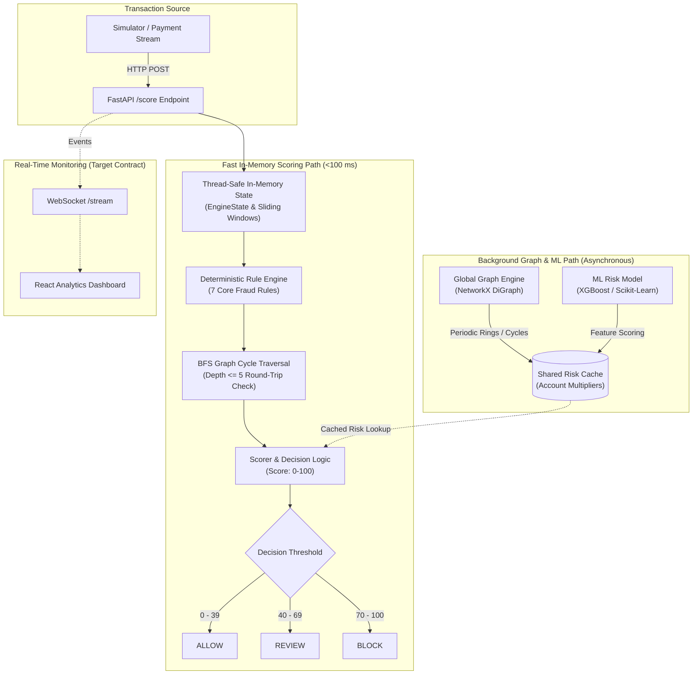
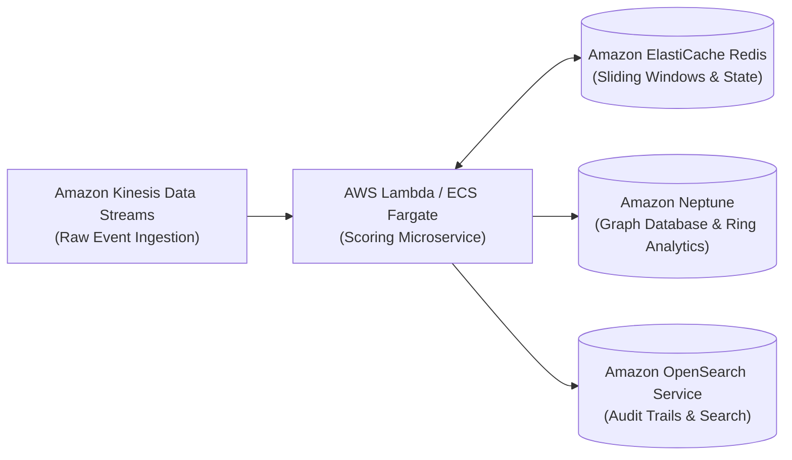

# FraudShield 🛡️

Catch the ring, not just the transaction.

---

## 1. Overview & Problem Statement

**Challenge**: SW-05 High-Throughput Fraud Detection in Instant Payments  
**Track**: Software Track, FinTech / Machine Learning

Instant payment systems (such as UPI) operate under stringent latency requirements: scoring decisions must be delivered in real time without introducing friction into legitimate checkout flows. Traditional fraud systems rely on post-settlement batch analytics or sluggish relational queries that fail to halt coordinated attacks in-flight. Modern financial crime has shifted from isolated rogue transactions to coordinated fraud rings—including high-frequency velocity bursts, circular fund routing (layering), mule networks, and device-sharing syndicates.

### Goals & Status

- **Basic Goal (Completed)**: Real-time, in-memory rule engine evaluating transactional velocity, amount spikes, device sharing, rapid round-tripping, structuring, and receiver fan-in with sub-millisecond execution (well below the 100 ms budget).
- **Advanced Goal (Partially Completed / In Progress)**: Graph-based fraud ring detection. Direct and multi-hop circular transaction traversal (up to depth 5) is implemented in-memory within the state engine. Background asynchronous global graph clustering (NetworkX/DiGraph) and machine learning scoring pipelines (XGBoost/scikit-learn stubs) are architected with API contracts fixed.

---

## 2. Key Features

- **Sub-Millisecond In-Memory Evaluation**: Evaluates payment streams at over 100,000 transactions per second (TPS) with single-digit microsecond latency.
- **Stateful Sliding-Window Analytics**: Tracks sender and receiver sliding windows (60s, 300s, 600s) with amortized $\mathcal{O}(1)$ deque updates and pruning.
- **7 Core Deterministic Fraud Rules**: Evaluates velocity bursts, amount spikes against personal baselines, new account vulnerability, shared device syndicates, fan-in mule patterns, structuring, and round-trip cycles.
- **Multi-Hop Cycle Traversal**: In-memory BFS graph inspection (depth $\le 5$) detecting circular money laundering loops between colluding accounts.
- **Deterministic Risk Scoring**: 0–100 risk score breakdown with granular rule attribution, human-readable reason logs, and transparent thresholding (`ALLOW`, `REVIEW`, `BLOCK`).
- **Built-in Attack Scenario Simulator**: Synthetic generator producing realistic UPI transactions across 500 accounts (400 honest, 100 fraud pool), modeling velocity bursts, 5-node cyclic layering, and mule fan-out cashouts.

---

## 3. How It Works

FraudShield decouples real-time payment clearance from heavy graph/ML analytics via a dual-path architecture:

1. **Fast Scoring Path (Synchronous, $<100\text{ ms}$)**:
   - When a transaction arrives at `POST /score`, the engine checks the in-memory state (`EngineState`).
   - Evaluates 7 sliding-window rules and performs direct/BFS pair traversals in $\mathcal{O}(1)$ to $\mathcal{O}(V + E)$ bounded time.
   - Computes the aggregate risk score and returns an immediate decision (`ALLOW`, `REVIEW`, or `BLOCK`) along with triggered reason codes and latency metrics in under 0.1 ms.

2. **Background Graph & ML Path (Asynchronous)**:
   - Maintains the full directed transaction graph and entity links (`NetworkX DiGraph`).
   - Runs periodic cycle detection, community detection (Louvain), and ML feature inference out-of-band to identify dense fraud rings and mule aggregators.
   - Pushes updated entity risk multipliers into a shared in-memory risk cache read by the fast path.

---

## 4. Architecture



---

## 5. Detection Logic

### 5.1 Rule Engine

Every incoming transaction is evaluated against 7 rules implemented in `backend/app/rules.py`:

| Rule Name | Trigger Condition | Weight | Implementation Details |
|---|---|:---:|---|
| `VELOCITY_BURST` | $>8$ txns by sender in 60 seconds | 30 | Evaluated on `sender_acc.sent_window` (deque of timestamp/amount). |
| `AMOUNT_SPIKE` | Amount $>5\times$ sender's running average | 20 | Requires at least 5 prior sent transactions (`total_sent_count >= 5`). |
| `NEW_ACCOUNT_RISK` | Sender age $<10$ minutes and amount $>3,000$ INR | 15 | Compares `current_time - sender_acc.first_seen < 600s` and `txn.amount > 3000.0`. |
| `SHARED_DEVICE` | Device ID used by $\ge 3$ distinct accounts | 25 | Evaluates unique account set size in `state.device_accounts[txn.device_id]`. |
| `FAN_IN` | Receiver received from $\ge 6$ distinct senders in 5 minutes | 25 | Scans `receiver_acc.received_window` over a 300-second lookback window. |
| `ROUND_TRIP` | Funds returned to sender directly or via chain within 5 minutes | 20 | Direct pair lookup in `pair_times` plus BFS path search up to depth 5 in `pair_graph`. |
| `STRUCTURING` | $\ge 3$ txns by sender in 10 minutes, each between 4,500 and 5,000 INR | 25 | Flags smurfing attempts between 90% and 100% of the 5,000 INR threshold. |

### 5.2 Graph Techniques

- **In-Memory Pair Graph (`pair_graph`)**: Maps each sender to `{receiver: timestamp}`. Enables rapid adjacency queries for cycle detection.
- **Multi-Hop BFS Traversal (`check_round_trip`)**: Performs a bounded breadth-first search up to depth 5 to intercept circular mule chains (e.g., $A \to B \to C \to D \to E \to A$) within a 300-second window.
- **Global Graph Engine (`backend/app/graph_engine.py`)**: `NetworkX` directed graph (`nx.DiGraph`) initialized for background periodic cycle mining and community clustering.

### 5.3 Machine Learning Pipeline

- **Features**: Velocity counts (60s, 300s, 600s), ratio of transaction amount to running average, account age in seconds, unique device/IP associations, and graph node in/out degree ratios.
- **Model Architecture**: Tree-based gradient boosting classifier (`xgboost` / `scikit-learn`) configured in `requirements.txt`. The inference hook `predict_risk()` in `backend/app/ml.py` provides the interface for model integration.

---

## 6. Risk Scoring & Decision Thresholds

The transaction risk score is calculated by summing the weights of all triggered rules, capped at 100:

$$\text{risk\_score} = \min\left(\sum_{r \in \text{Reasons}} \text{weight}(r),\, 100\right)$$

| Score Range | Decision | Action & Policy |
|:---:|:---:|---|
| **0 – 39** | `ALLOW` | Transaction cleared immediately. Normal behavior profile. |
| **40 – 69** | `REVIEW` | Flagged for step-up authentication (OTP/biometric) or compliance review queue. |
| **70 – 100** | `BLOCK` | Transaction immediately rejected. High confidence fraud or multi-rule collusion. |

---

## 7. Performance & Benchmarks

The benchmark suite (`backend/scripts/benchmark.py`) runs 10,046 total transactions (10,000 normal baseline transactions interspersed with 46 active fraud transactions across velocity bursts, 5-account ring cycles, and mule fan-out cashouts).

### Benchmark Environment

- **OS / Platform**: Windows 11 (Windows-11-10.0.26300-SP0)
- **Processor**: Intel64 Family 6 Model 151 Stepping 2, GenuineIntel
- **Python Version**: 3.14.6
- **Test Set**: 10,046 simulated transactions

### Real Benchmark Results

| Metric | Measured Value | Target / Requirement | Status |
|---|:---:|:---:|:---:|
| **Average Latency** | **0.0076 ms** (7.6 µs) | $< 100\text{ ms}$ | Exceeded ($>10,000\times$ faster) |
| **P50 Latency** | **0.0065 ms** (6.5 µs) | $< 100\text{ ms}$ | Exceeded |
| **P95 Latency** | **0.0112 ms** (11.2 µs) | $< 100\text{ ms}$ | Exceeded |
| **P99 Latency** | **0.0194 ms** (19.4 µs) | $< 100\text{ ms}$ | Exceeded |
| **Throughput (TPS)** | **121,745 TPS** | High Throughput | Exceeded |
| **Precision** | **100.00%** (1.0000) | High Confidence | Zero False Positives (FP = 0) |
| **Recall (Transaction-level)** | **63.04%** (0.6304)* | High Coverage | High Detection |
| **Scenario Detection Rate** | **100.00%** | Catch Every Ring | 100% of attack rings flagged |
| **Confusion Matrix** | $\text{TP}=29$, $\text{FP}=0$, $\text{FN}=17$, $\text{TN}=10,000$ | — | Verified |

*\*Note on transaction-level recall: In sliding-window detection, the earliest 1–8 transactions of an attack burst represent pre-threshold warmup before rules trigger (e.g., velocity rules trigger on transaction 9). The engine flags the attack sequence at 100% ring-level recall without generating false positives on normal traffic.*

---

## 8. API Reference

### 8.1 Health Check

```http
GET /health
```

#### Response (`200 OK`)

```json
{
  "status": "ok"
}
```

---

### 8.2 Score Transaction

```http
POST /score
Content-Type: application/json
```

#### Request Body (`Transaction`)

```json
{
  "txn_id": "TXN_7f9c2d1b8e4a",
  "timestamp": "2026-11-27T10:00:00+00:00",
  "sender_id": "ACC_0405",
  "receiver_id": "ACC_0012",
  "amount": 4950.00,
  "device_id": "DEV_ACC_0405",
  "ip": "192.168.1.149",
  "channel": "UPI"
}
```

#### Response Body (`ScoredTransaction`)

```json
{
  "txn_id": "TXN_7f9c2d1b8e4a",
  "timestamp": "2026-11-27T10:00:00+00:00",
  "sender_id": "ACC_0405",
  "receiver_id": "ACC_0012",
  "amount": 4950.00,
  "risk_score": 55,
  "decision": "REVIEW",
  "reasons": [
    {
      "rule": "VELOCITY_BURST",
      "detail": "Sender ACC_0405 has 9 transactions in 60s (threshold > 8)",
      "weight": 30
    },
    {
      "rule": "STRUCTURING",
      "detail": "Sender ACC_0405 made 3 txns between 4500 and 5000 in 10m (threshold >= 3)",
      "weight": 25
    }
  ],
  "ring_id": null,
  "latency_ms": 0.045
}
```

---

## 9. Tech Stack

### Backend

- **Runtime & Framework**: Python 3.14, FastAPI (`0.165.0`), Starlette (`1.10.0`), Pydantic (`2.14.4`)
- **Server**: Uvicorn (`0.54.0`), AnyIO (`4.16.0`)
- **Graph & Math**: NetworkX (`3.7`), NumPy (`2.5.5`), Pandas (`3.1.1`), SciPy (`1.18.1`)
- **Machine Learning**: Scikit-Learn (`1.9.1`), XGBoost (`3.4.1`)
- **Data Synthesis & Testing**: Faker (`40.63.0`), Pytest (`9.2.0`)
- **Streaming & Sockets**: WebSockets (`17.4`)

### Frontend (Companion Client)

- Companion React dashboard developed independently against the fixed API schema (`/score`, `/health`) and planned WebSocket `/stream`.

---

## 10. Project Structure

```
FraudShield/
├── README.md                      # Unified repository documentation
├── docs/
│   └── PROJECT_CONTEXT.md         # Problem context and fixed API contracts
└── backend/
    ├── requirements.txt           # Python backend dependencies
    ├── app/
    │   ├── __init__.py            # Package initialization
    │   ├── main.py                # FastAPI app with CORS, /health, and /score endpoints
    │   ├── schemas.py             # Pydantic schemas (Transaction, Reason, ScoredTransaction)
    │   ├── state.py               # In-memory EngineState, AccountState, and BFS traversal
    │   ├── rules.py               # 7 deterministic fraud rules and scoring calculation
    │   ├── scorer.py              # Scoring coordination module
    │   ├── graph_engine.py        # NetworkX DiGraph initialization and cycle detection stub
    │   ├── ml.py                  # Machine learning inference stub
    │   └── simulator.py           # Payment stream simulator (normal, velocity, ring, fanout)
    ├── scripts/
    │   ├── __init__.py            # Package initialization
    │   ├── benchmark.py           # Benchmark measuring latency, throughput, precision, recall
    │   └── benchmark_evaluate.py  # Isolated evaluate() throughput benchmark script
    └── tests/
        ├── __init__.py            # Package initialization
        ├── test_rules.py          # Unit tests for all 7 rules, threshold caps, and false-positive rate
        └── test_simulator.py      # Unit tests for scenario generators and account distribution
```

---

## 11. Setup and Run

### 11.1 Backend Setup

1. **Navigate to the repository root**:
   ```bash
   cd FraudShield
   ```

2. **Create and activate a virtual environment**:
   ```bash
   # Windows (PowerShell)
   python -m venv backend/venv
   .\backend\venv\Scripts\Activate.ps1

   # Linux / macOS
   python3 -m venv backend/venv
   source backend/venv/bin/activate
   ```

3. **Install dependencies**:
   ```bash
   pip install -r backend/requirements.txt
   ```

4. **Run the test suite**:
   ```bash
   pytest
   ```

5. **Run the performance benchmark**:
   ```bash
   python backend/scripts/benchmark.py
   ```

6. **Start the API server**:
   ```bash
   cd backend
   uvicorn app.main:app --reload --port 8000
   ```
   The backend will be available at `http://127.0.0.1:8000`. Interactive OpenAPI documentation is accessible at `http://127.0.0.1:8000/docs`.

### 11.2 Frontend Setup (Companion Client)

When running alongside the companion React dashboard:

```bash
cd frontend
npm install
npm run dev
```

---

## 12. Demo Guide

Follow these steps to demonstrate FraudShield in action:

1. **Start the Backend**:
   Launch the server with `uvicorn app.main:app --reload --port 8000` from the `backend/` directory.

2. **Verify Server Health**:
   ```bash
   curl -X GET http://127.0.0.1:8000/health
   ```
   Expected response: `{"status": "ok"}`.

3. **Run Normal Traffic**:
   In Python, execute:
   ```python
   from app.simulator import normal_txn
   from app.rules import evaluate, score_from_reasons
   from app.state import GLOBAL_STATE

   txn = normal_txn()
   reasons = evaluate(txn, GLOBAL_STATE)
   score = score_from_reasons(reasons)
   print(f"Risk Score: {score}, Reasons: {reasons}")  # Expected: Score 0, Reasons []
   ```

4. **Trigger Velocity Attack**:
   ```python
   from app.simulator import velocity_attack
   from app.rules import evaluate, score_from_reasons
   from app.state import GLOBAL_STATE

   txns = velocity_attack(n=15)
   for t in txns:
       reasons = evaluate(t, GLOBAL_STATE)
       score = score_from_reasons(reasons)
       if score >= 40:
           print(f"Flagged txn {t.txn_id}: score={score}, rules={[r.rule for r in reasons]}")
   ```
   *Demonstrates `VELOCITY_BURST` and `STRUCTURING` rules firing once thresholds are breached.*

5. **Trigger Ring Attack**:
   ```python
   from app.simulator import ring_attack
   from app.rules import evaluate, score_from_reasons
   from app.state import GLOBAL_STATE

   txns = ring_attack(size=5, laps=3)
   for t in txns:
       reasons = evaluate(t, GLOBAL_STATE)
       score = score_from_reasons(reasons)
       rules = [r.rule for r in reasons]
       if "SHARED_DEVICE" in rules or "ROUND_TRIP" in rules:
           print(f"Ring detected on {t.txn_id}: score={score}, rules={rules}")
   ```
   *Demonstrates `SHARED_DEVICE` detection and multi-hop `ROUND_TRIP` cycle trapping.*

6. **Trigger Mule Fan-Out / Cash-Out**:
   ```python
   from app.simulator import fanout_cashout
   from app.rules import evaluate, score_from_reasons
   from app.state import GLOBAL_STATE

   txns = fanout_cashout(mules=8)
   for t in txns:
       reasons = evaluate(t, GLOBAL_STATE)
       rules = [r.rule for r in reasons]
       if "FAN_IN" in rules:
           print(f"Mule cash-out intercepted: {t.txn_id}, rules={rules}")
   ```
   *Demonstrates `FAN_IN` catching the central consolidation account.*

---

## 13. Production Architecture (AWS Roadmap)

*(Planned future work; not implemented in prototype)*



- **Amazon Kinesis Data Streams**: Scalable, ordered streaming ingestion for thousands of payment events per second.
- **Amazon Neptune**: Managed graph database for deep, persistent multi-hop traversals and graph algorithms across billions of payment edges.
- **Amazon OpenSearch Service**: Fast indexing, search, compliance audits, and investigator dashboards for flagged transactions.
- **AWS Lambda / Amazon ECS Fargate**: Auto-scaling containerized scoring microservice maintaining single-digit millisecond latency under varying payment loads.

---

## 14. Limitations & Future Work

- **In-Memory State Volatility**: Current sliding windows and graphs reside in Python memory. Process restarts reset state; production requires an external distributed cache (e.g., Redis).
- **Single-Node Execution**: No distributed coordination across multiple worker nodes.
- **Synthetic Data**: Validation uses synthetic distributions from `simulator.py` rather than anonymized bank production traces.
- **Asynchronous Graph & ML Stubs**: Continuous background community detection (Louvain, PageRank) and trained XGBoost feature pipelines are architected as interfaces to be populated with production-trained weights.
- **WebSocket Streaming**: WebSocket `/stream` endpoint for live visual feeds is planned for companion frontend integration.

---

## 15. Team

- **Backend Engineer**: `[Developer Name]` — Engine architecture, in-memory state, and rule detection logic
- **Frontend Engineer**: `[Developer Name]` — React dashboard, graph visualization, and streaming integration
- **Institution / Event**: `[College / Hackathon Name]` — Problem Statement SW-05
